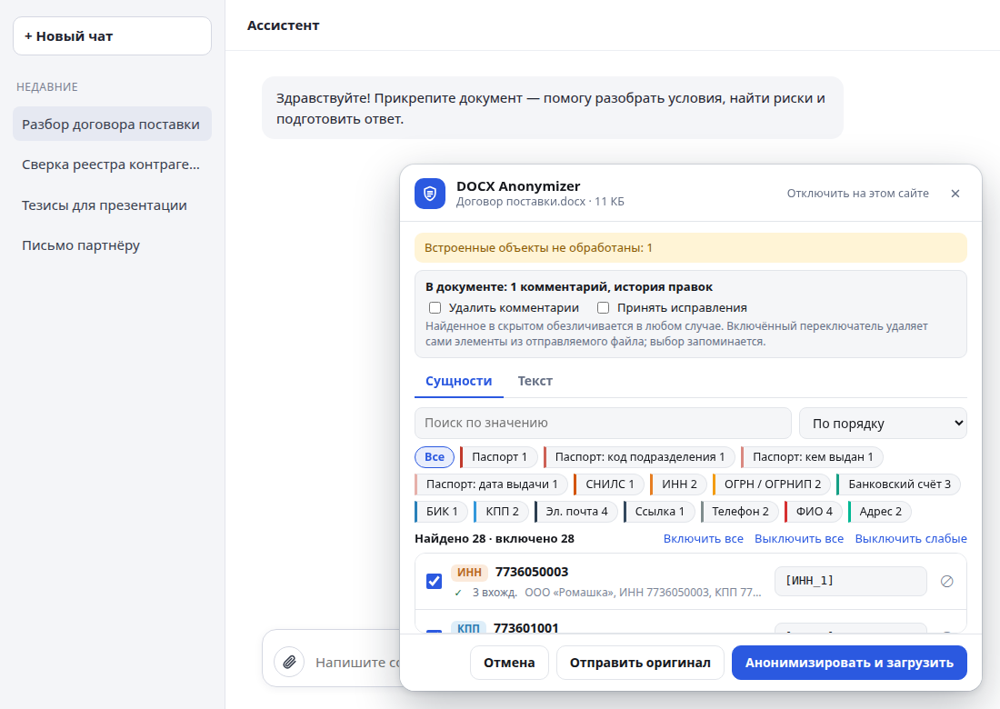
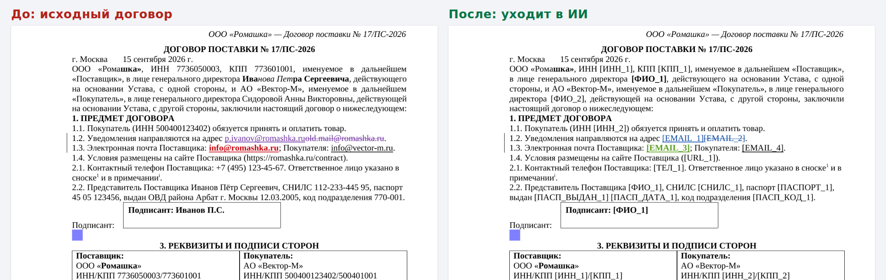
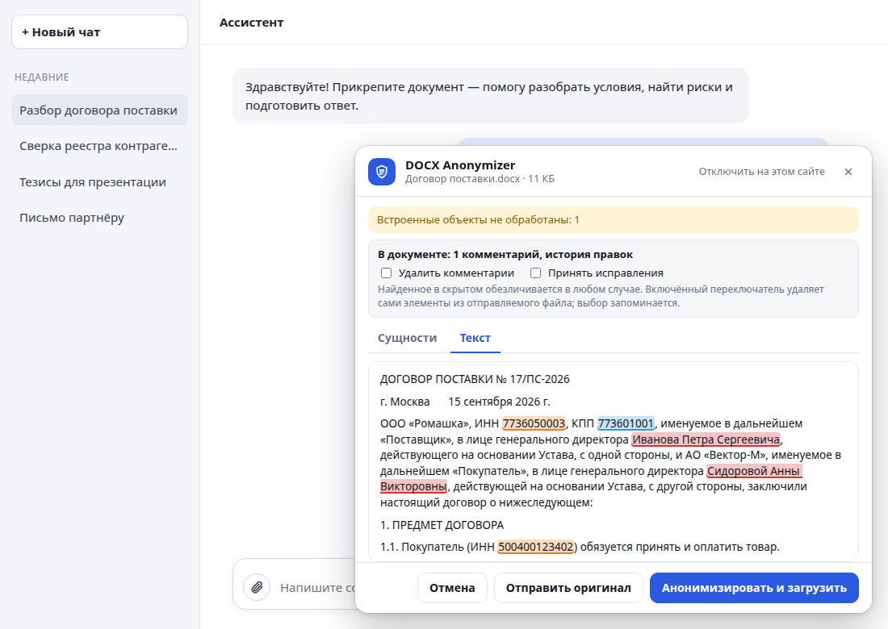
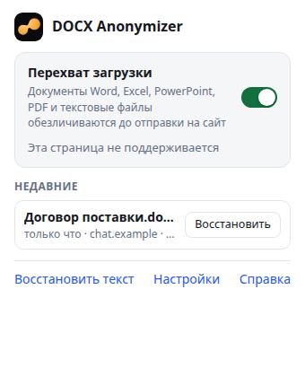
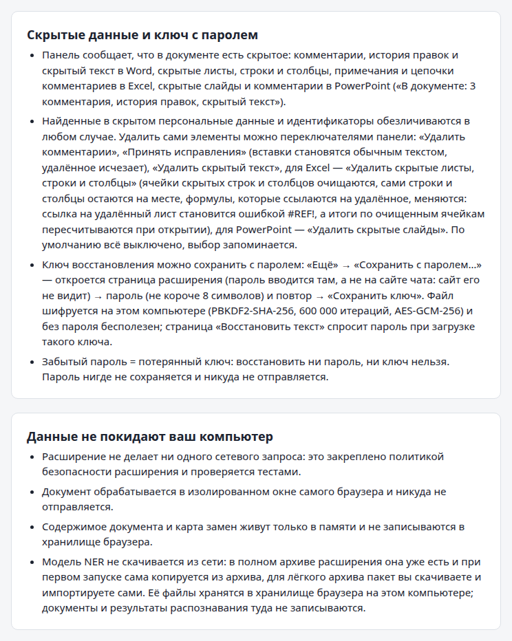
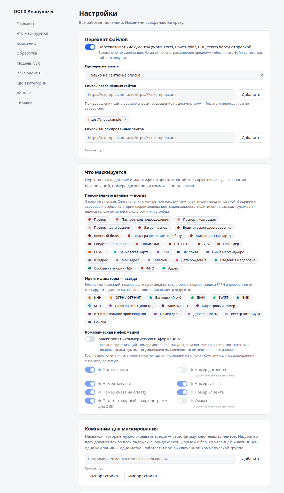
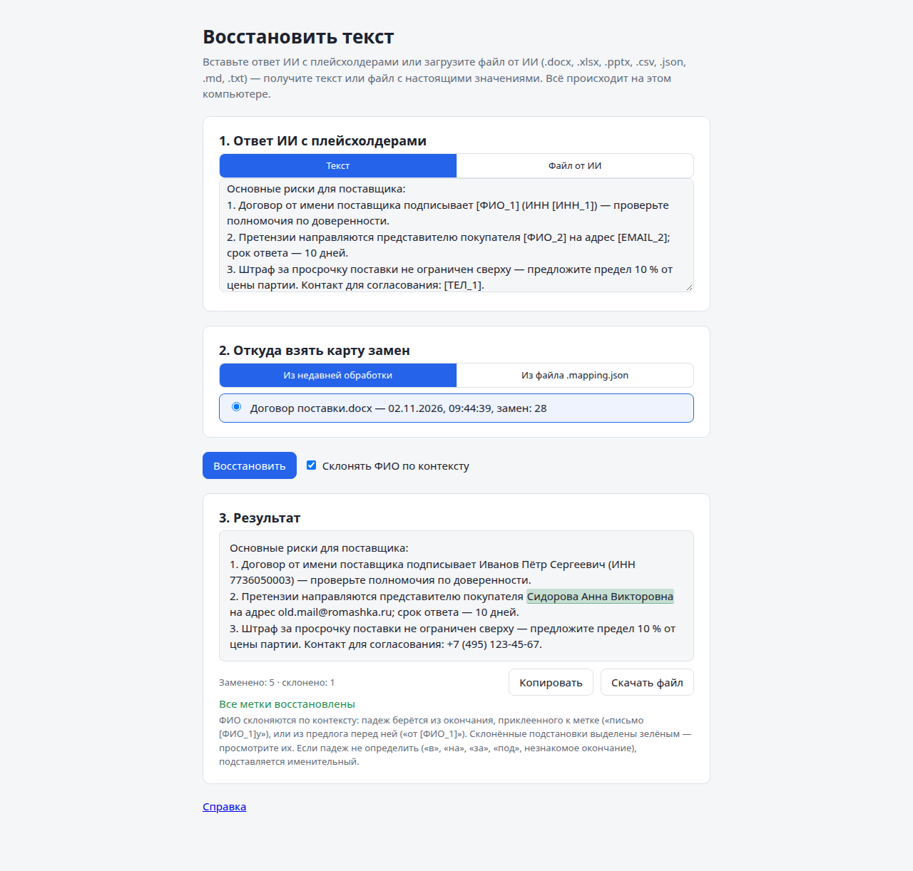

# DOCX Anonymizer

Расширение для Chrome и Edge: перед тем как договор, таблица или презентация попадёт в ChatGPT, Claude или другой ИИ-сервис, оно **перехватывает файл, локально находит в нём персональные данные и реквизиты и заменяет их плейсхолдерами** (названия компаний, номера договоров и суммы — по желанию). Форматы (версия 0.5): Word `.docx`/`.docm`, Excel `.xlsx`/`.xlsm`, PowerPoint `.pptx`/`.pptm`, PDF с текстовым слоем, `.txt`, `.md`, `.csv`, `.json`, `.log`. В сервис уходит обезличенный файл того же формата с сохранённым форматированием (из PDF — его текст с плейсхолдерами); комментарии, история правок и скрытый текст удаляются по вашему выбору; ответ ИИ — текстом или файлом — можно вернуть обратно с настоящими названиями и именами, а ключ восстановления — защитить паролем.

<b>English summary</b>

**DOCX Anonymizer** is a Chrome/Edge extension that intercepts a document the moment you attach it to ChatGPT, Claude or another AI chat, finds personal data and company identifiers in it **locally** (company names, contract numbers and amounts — if you choose), and uploads an anonymized copy instead. Formats (0.5): Word `.docx`/`.docm`, Excel `.xlsx`/`.xlsm`, PowerPoint `.pptx`/`.pptm`, PDF with a text layer (the chat gets its text with placeholders), and text files `.txt`, `.md`, `.csv`, `.json`, `.log`. Formatting, tables, formulas, slides, notes, footnotes and headers are preserved; file metadata is wiped. The AI's answer — pasted text or a file the AI produced (`.docx`, `.xlsx`, `.pptx`, `.csv`, `.json`, `.md`, `.txt`) — can be de-anonymized back on the "Restore text" page using a replacement map (the recovery key) that never leaves your computer; a restored file keeps its formatting. In files only markers written exactly as in the map or in square brackets are replaced (so "Account 1" in the document text stays), names are declined by context, and the page warns about a marker that stood for several different values. The recovery key is saved from the panel's "More" menu — optionally protected with a password.

**What is masked (0.4, extended in 0.5).** 50 categories with checksum or format validation where one exists, in three groups. *Personal data — always:* names, passports (series and number, issuing authority, date of issue and department code — four separate markers since 0.5), international passports, driver's licenses, military IDs, residence and work permits, migration cards, civil status certificates, OMS health insurance policies (check digit), vehicle documents, VINs, license plates, IP and MAC addresses, messenger handles, SNILS, SSN, phones, e-mails, postal addresses, dates of birth, bank cards; health data and special categories (religion, ethnicity, political views, criminal record) — only by an explicit label or table column header. *Identifiers — always:* INN, KPP, OGRN/OGRNIP, bank accounts, IBAN, BIK, SWIFT, foreign tax IDs, URLs, cadastral numbers and land registry records, court case and enforcement numbers, powers of attorney and notarial register numbers — even when the company name stays visible. These two groups cannot be switched off in the settings (a single finding can still be unchecked in the panel). *Commercial information — optional, off by default:* company names (Russian and Western legal forms), contract, tender, order, invoice and customer numbers, patents and trademarks, amounts; turn it on in the settings, "What is masked" → "Mask commercial information". A sole trader ("ИП Petrov P. P.") is a person: the name is always masked as a name, together with the INN and OGRNIP. The extension developer's brand, Sitimlab, is never masked. Your own dictionaries, label+pattern rules and regular expressions work as before. Person names are found by labels and the parties' details block, by first-name and surname dictionaries with Russian morphology (any case, initials, transliteration, a greeting with a first name only — "Elena, thanks…", a name or surname after a job title — "courier Abdullaev"), and optionally by a local NER model.

**Companies to mask.** The settings page has a list of company names that are masked in every document even with the commercial group off — your own firm, key clients. Each name is found in every Russian grammatical case, with or without the legal form and quotes, in Cyrillic and Latin ("Romashka" ↔ "Ромашка"), plus aliases you add; one company gets one placeholder throughout. Add names in the settings, with "Always mask" in a company row of the panel (commercial mode) or with the "remember" checkbox in "Anonymize as → Company" on the "Text" tab. The list can be exported and imported as JSON (`companies.json`); short or common words ("Start") get a warning because they would also be masked in ordinary text.

**Formats, in detail (0.5).** Excel: cell text, comments and notes, sheet headers and footers, sheet names (renamed only when they contain an entity, with a warning), document properties; formulas are never changed — an identifier stored as a number (INN, account, phone, found by its format and the column header) becomes a text cell, a text literal inside a formula is warned about. PowerPoint: slides, speaker notes, tables, groups, comments. CSV keeps its delimiter and encoding; JSON keeps its keys and stays valid JSON. One value gets one placeholder across the whole workbook or deck. VBA macros are not anonymized and pass as is (the panel warns).

**Hidden content (0.5).** The panel reports comments, tracked changes and hidden text in Word, hidden sheets, rows, columns and comments in Excel, hidden slides and comments in PowerPoint ("The document has: 3 comments, tracked changes, hidden text") and offers switches — "Remove comments", "Accept tracked changes", "Remove hidden text", "Remove hidden sheets, rows and columns", "Remove hidden slides". All are off by default, the choice is remembered; personal data inside hidden content is anonymized in any case.

**Password-protected recovery key (0.5, optional).** "More" → "Save with a password…" opens an extension page (the password is typed there, not on the chat site): PBKDF2-SHA-256 with 600 000 iterations → AES-GCM-256; the "Restore text" page asks for the password when such a key is loaded. The password is never stored: a forgotten password means a lost key.

**Upgrading from 0.4.** New formats are intercepted by themselves once the site is allowed; the hidden-content switches start switched off; passport details get four separate placeholders (a key saved by 0.4 still restores, with a warning); the full archive installs NER model 1.2.0 by itself over 1.1.0 or 1.0.0. Settings migrate without your action.

**Upgrading from 0.3.** Company names are no longer masked by default — for every profile, without exceptions; personal data and identifiers stay masked. The panel shows a one-time hint about it with a link to the settings. Settings migrate by themselves (schema 3: personal data and identifiers are switched on in every saved profile, the commercial group is off). The full archive installs NER model 1.1.0 by itself over 1.0.0.

**NER model.** A compact `rubert-tiny2` (package 1.2.0) fine-tuned on WikiANN ru+en, factRuEval-2016, NEREL, a sample of Nerus and synthetic business documents (16 genres incl. initials without spaces, foreign names, bare first names and surnames, table rows, homonyms and the document numbers of version 0.5 — 42 % of the training set), exported to ONNX (int8; 30 MB, package zip ≈ 28 MB) and run by onnxruntime-web (WASM) inside the extension's worker. The full release archive (`docx-anonymizer-<version>-full.zip`, ≈ 36 MB) already contains it and installs it on first run, with no download and no import (if that fails, the settings card says so and offers Retry); a profile that had package 1.1.0 or 1.0.0 gets 1.2.0 automatically after the update, while a model you removed is not brought back. The lite archive (≈ 6 MB) leaves it out — then take the model package from [GitHub Releases](https://github.com/argmaster-dev/docx-anonymizer/releases) and import it on the settings page. WikiANN test F1 (int8): ru — PER 0.912, ORG 0.754, LOC 0.863; en — PER 0.811, ORG 0.663, LOC 0.775 (1.1.0: 0.913 / 0.757 / 0.863 — ORG is 0.002–0.004 lower, within seed variance; gates 0.91 and 0.75 passed); factRuEval-2016 ru: PER 0.894, ORG 0.727 (1.1.0: 0.861 / 0.704). On 86 hand-written held-out names (foreign names, a bare first name or surname, one-initial signatures, initials without spaces, vocatives, table rows) the model finds 93 % (1.1.0 — 81 %; optimistic: the names are new, the sentence frames resemble the synthetic templates); "Комаров Р.А." is now one entity. On the genre corpus (19 genres incl. the 0.5 forms, court, real estate, vehicle, medical, Excel, PowerPoint, CSV and JSON) with the model PERSON and COMPANY precision and recall are 1.00 in every genre with zero leaks. Compared with Natasha (Slovnet): document-level person F1 of the model 0.93–0.94 vs 0.84, the whole pipeline 0.90–0.92 and companies 1.00 vs 0.42–0.72 (`tools/ner-train/README.md`; not fully independent — the Nerus sample is labelled automatically by Slovnet). These document numbers come from synthetic data and a genre corpus written by the same author; no real-world documents are in the measurements. Cold start 0.27 s, a 20-page contract 1.9 s for the model. Training data and licenses: WikiANN (Wikipedia text, CC BY-SA 3.0), factRuEval-2016 (MIT annotations, OpenCorpora texts CC BY-SA 3.0), NEREL and Nerus, own synthetic data. **Part of the training corpora (NEREL, Nerus) has no explicit license on its texts: the model pack is provided as is and used at your own risk.** Only weights are distributed — see `NOTICE` in the package and [`tools/ner-train/README.md`](tools/ner-train/README.md).

**Privacy.** Zero network requests: the manifest's CSP is `connect-src 'self'`, ESLint forbids `fetch`/`XMLHttpRequest`/`WebSocket`/`EventSource`/`sendBeacon` in the source (one exception: `src/offscreen/package-fetch.js` reads the bundled model zip from the extension's own package, `chrome-extension://`), and an end-to-end test captures traffic of every browser target (pages, service worker, offscreen document and its worker) to prove nothing leaves the machine. Document contents and the replacement map live only in memory. Site access is granted per site on request (`optional_host_permissions`); nothing is injected elsewhere.

**Install.** Chrome or Edge 132+. Node.js 22+, `npm ci`, `npm run build`, then load `dist/` as an unpacked extension at `chrome://extensions`. Or take a release archive: `docx-anonymizer-<version>-full.zip` (≈ 35 MB, with the NER model, installs itself) or the lite `docx-anonymizer-<version>.zip` (≈ 6 MB). A package for the Chrome Web Store and Edge Add-ons (`npm run pack:store`, texts, screenshots and the privacy policy in [`docs/store/`](docs/store/checklist.md)) is prepared but not submitted. The extension gets no site access at install time: enable interception for a site from the extension menu and accept Chrome's access prompt.

**Update.** No auto-update: unpacked extensions are updated by hand. Unzip the new release over the same folder (or into a new one) and press "Update" at `chrome://extensions` (for a new folder: remove the old entry, load the new one). The extension ID is pinned by the `key` field in `manifest.json`, so settings, granted site access and the installed NER model survive an update from any folder; a new model package in the full archive installs itself on the first run. Versions 0.2 and older had no key: upgrading from them means a fresh install.

**PDF.** A PDF with a text layer is intercepted too: pdf.js (bundled in the extension, no network) extracts the text, a layout step rebuilds paragraphs, headings, lists, two-column pages and tables and drops running headers and page numbers, and the chat receives `name.anon.md` (or `.txt`) with placeholders instead of the PDF. The setting "PDF with a text layer" switches the output to `.txt` or turns PDF interception off. Scans, password-protected, empty and damaged PDFs are refused with a hint and can be uploaded as is after an explicit choice.

**Limits.** No scans or images (OCR is planned for 0.6), no PDF → PDF; PDF layout is tested on Chromium and LibreOffice PDFs; health data and special categories (religion, ethnicity, political views, criminal record) are found only by an explicit label or column header; all quality numbers come from synthetic data and a genre corpus written by one author — no real-world documents are in the measurements, so always review the result; AI files are restored from `.docx`/`.docm`/`.xlsx`/`.xlsm`/`.pptx`/`.pptm`/`.csv`/`.json`/`.md`/`.txt`, not PDF; embedded OLE objects are not anonymized (warned about or removed); single surnames of third parties without a label are found only by the NER model; the voice assistant name "Алиса" (Alice) is left unmasked only in an unambiguous context ("Яндекс Алиса", "voice assistant Алиса", a list of AI products) and is masked when a verb or "and + a name" follows it in the same clause; placeholder-like markers such as "⟦ORG_1⟧" or "⟦ORG_1.INN⟧" (category code, number and an optional requisite field from a closed list) are not turned into entities by the model, any other value in such brackets ("⟦ИВАНОВ⟧", "⟦ФИО_1.ПЕТРОВ⟧") is masked; Russian case restoration skips ambiguous prepositions. The UI is Russian-first with full English localization.

**Development.** `npm test` (Vitest, ~3 300 tests), `npm run e2e` (Playwright, Chromium with the extension), `npm run lint`, `npm run pack` (reproducible lite and full release archives), `npm run pack:store` (store package without the `key` field, checked against store requirements), `npm run store:shots` (store and README screenshots), `npm run pack:model`, `npm run gen-pdf-fixtures`, `npm run gen-genre-fixtures` / `gen-heldout-fixtures` (genre corpus and held-out set), `npm run eval-genres` (precision/recall per genre, category and mode; `NER_MODEL_DIR=…` adds the model, `PRIVATE_FIXTURES=1` adds your own documents from the git-ignored `tests/fixtures/private/`, printing counts only), `tools/ner-train` (Python/uv training pipeline). MIT license; dictionaries, ONNX Runtime Web (MIT), pdf.js (Apache-2.0) and the model carry their own notices.

## Зачем

Договор — это реквизиты, ФИО подписантов, паспортные данные, счета, адреса. Загружать такое в облачную нейросеть нельзя или опасно, но разобрать договор с помощью ИИ хочется. Расширение убирает эту дилемму: ИИ видит структуру и условия, а реальные данные не покидают ваш компьютер.

## Как это работает

1. **Перехват.** Вы прикладываете документ в чате (кнопкой, перетаскиванием или вставкой): Word, Excel, PowerPoint, PDF или текстовый файл (раздел [«Форматы»](#форматы)). Расширение останавливает файл до отправки и показывает панель: что найдено, где, с возможностью снять лишние галочки; если в документе есть комментарии, история правок или скрытый текст — сообщает и предлагает их удалить.
2. **Замена.** Нажимаете «Анонимизировать и загрузить» — в чат уходит `имя.anon.docx`: данные заменены плейсхолдерами (`[ФИО_1]`, `[ИНН_1]`, `[СЧЕТ_1]`; названия компаний — `ООО «[КОМПАНИЯ_1]»` — если вы их включили, раздел [«Что маскируется»](#что-маскируется)), форматирование, таблицы, сноски и колонтитулы сохранены, метаданные файла очищены. Так же из книги Excel уходит `имя.anon.xlsx`, из презентации — `имя.anon.pptx`, из CSV и JSON — файл того же вида. Одно и то же значение везде получает один плейсхолдер. Из PDF в чат уходит `имя.anon.md` — текст документа с теми же плейсхолдерами (раздел [«PDF»](#pdf)).
3. **Восстановление.** Ответ ИИ вставляете на странице «Восстановить текст» или загружаете файлом от ИИ (`.docx`, `.xlsx`, `.pptx`, `.csv`, `.json`, `.md`, `.txt`) — расширение подставляет настоящие значения из карты замен (ключа восстановления), которая хранится только у вас, и склоняет ФИО по контексту.

Перед отправкой можно проверить текст документа с подсвеченными находками:

## Установка

Расширение пока не опубликовано в магазинах, оно ставится как распакованное. Пакет для Chrome Web Store и Edge Add-ons, тексты листинга, скриншоты и политика конфиденциальности подготовлены ([`docs/store/`](docs/store/checklist.md), `npm run pack:store`), подача — отдельное решение. Нужен Chrome или Edge версии 132 и новее.

1. Возьмите сборку: соберите её сами — Node.js 22+, `npm ci`, `npm run build`, появится каталог `dist/` — или распакуйте в отдельную папку архив релиза (`npm run pack`, см. ниже; архивы выкладываются в [GitHub Releases](https://github.com/argmaster-dev/docx-anonymizer/releases)). Архивов два:
   - **полный** `docx-anonymizer-<версия>-full.zip` (≈ 35 МБ) — с моделью NER: при первом запуске она ставится сама, ничего скачивать и импортировать не нужно;
   - **лёгкий** `docx-anonymizer-<версия>.zip` (≈ 6 МБ) — без модели: всё работает правилами и словарями, модель можно добавить позже (раздел «Распознавание имён моделью»).
2. Chrome → `chrome://extensions` → включите «Режим разработчика».
3. «Загрузить распакованное расширение» → выберите распакованную папку архива или `dist/`. При установке Chrome не предупреждает о доступе к данным на сайтах: расширение не получает доступа ни к одному сайту, пока вы его не выдадите (разрешения по запросу).
4. Откройте сайт чата и меню расширения, включите «Перехват загрузки» (по умолчанию выключен).
5. **Подтвердите доступ к сайту.** Для сайтов из списка по умолчанию (ChatGPT, Claude, Gemini, DeepSeek, Perplexity) нажмите в меню «Разрешить доступ», для другого сайта — «Добавить …»; Chrome спросит разрешение на доступ к этому сайту — нажмите «Разрешить». Перезагружать страницу не нужно. Сайты можно добавлять и в настройках (раздел «Перехват»): при добавлении Chrome спрашивает разрешение так же, отозвать доступ можно в `chrome://extensions` → «Сведения» → «Доступ к сайтам».

### Обновление

Автообновления нет: расширение не в магазине, а Chrome не обновляет распакованные расширения сам. О новых версиях сообщает страница [Releases](https://github.com/argmaster-dev/docx-anonymizer/releases) (расширение не делает запросов в сеть и само о них не узнаёт).

1. Скачайте архив новой версии, полный или лёгкий.
2. Распакуйте его в папку, из которой расширение загружено, с заменой файлов (старое содержимое папки лучше сначала удалить), или в новую папку.
3. `chrome://extensions` → «Обновить» вверху страницы или кнопка перезагрузки на карточке расширения. Если распаковали в новую папку — «Удалить» старое и «Загрузить распакованное расширение» для новой.

Идентификатор расширения закреплён полем `key` в `manifest.json`, поэтому при обновлении из любой папки сохраняются настройки, список сайтов с выданным доступом и установленная модель NER. Если в полном архиве новый пакет модели, он ставится сам при первом запуске после обновления; тот же пакет повторно не ставится. Версии 0.2 и старше ключа не имели: при переходе с них Chrome увидит новое расширение — удалите старое, настройки и доступ к сайтам придётся выдать заново (модель из полного архива поставится сама, для лёгкого — импортируйте пакет снова).

### Что изменится после обновления с 0.4

- **Новые форматы перехватываются сами** — Excel, PowerPoint, CSV, JSON, `.txt`/`.md`/`.log` — на тех же сайтах, где включён перехват; ничего настраивать не нужно.
- **Скрытые данные.** Если в документе есть комментарии, история правок, скрытый текст, скрытые листы или слайды, панель сообщает об этом и показывает переключатели удаления; все выключены, пока вы их не включите (раздел [«Скрытые данные»](#скрытые-данные)).
- **Паспорт — четыре метки** вместо одной: серия и номер, кем выдан, дата выдачи, код подразделения. Ключ восстановления, сохранённый в 0.4, по-прежнему работает (с предупреждением, если под одной меткой были разные значения).
- **Новые категории** (анкеты, суды, недвижимость, транспорт, медицина) включены сразу: персональные данные и идентификаторы маскируются всегда, новые коммерческие номера — вместе с коммерческой группой.
- **Модель NER 1.2.0 ставится сама** из полного архива 0.5 поверх 1.1.0 или 1.0.0; с лёгким архивом — импорт вручную.
- Настройки мигрируют сами; новые переключатели скрытых данных получают значение «выключено».

### Что изменится после обновления с 0.3

- **Организации больше не маскируются по умолчанию** — у всех профилей, без исключений для старых настроек. Персональные данные и идентификаторы (ИНН, КПП, счета) по-прежнему закрываются всегда. Чтобы маскировать названия, как в 0.3, включите в настройках «Что маскируется» → «Маскировать коммерческую информацию» или внесите нужные компании в [список](#компании-для-маскирования).
- **Подсказка в панели.** При первом анализе после обновления панель один раз сообщает, что названия организаций теперь маскируются по желанию, со ссылкой «Открыть настройки» (раздел «Что маскируется») и кнопкой «×»; больше она не появляется. При новой установке подсказки нет.
- **Миграция настроек** проходит сама (схема настроек 3): в сохранённых настройках и во всех профилях включаются категории персональных данных и идентификаторов (если какую-то из них в 0.3 выключали), коммерческая группа выключена; остальные настройки, исключения, свои категории и профили сохраняются. Файл настроек, экспортированный из 0.3, импортируется с той же миграцией.
- **Модель NER 1.1.0 ставится сама** из полного архива 0.4 поверх 1.0.0 — и встроенного из полного архива 0.3, и импортированного вручную; в хранилище остаётся одна копия. С лёгким архивом пакет 1.1.0 импортируется вручную; 1.0.0 продолжает работать. Подробно — [«Распознавание имён моделью»](#распознавание-имён-моделью-ner).
- **Новые настройки модели** (раздел «Модель NER»): отдельный порог для организаций (по умолчанию 0,85; для людей и мест — прежний 0,7) и список слов «Не считать организациями» — оба действуют в коммерческом режиме.

### Архив релиза

`npm run pack` собирает расширение и пакует его в `release/docx-anonymizer-<версия>.zip` — лёгкий архив (≈ 6,3 МБ, `manifest.json` — в корне архива; сеть не нужна, `dist/` не затрагивается). Если в `release/` есть пакет модели из списка проверенных (`npm run pack:model`, см. «Распознавание имён моделью»; при нескольких берётся пакет с наибольшей версией, zip, которых нет в списке, пропускаются с предупреждением) или он указан явно (`npm run pack -- --model=<zip>`), рядом появляется полный `release/docx-anonymizer-<версия>-full.zip` (≈ 35 МБ): то же расширение плюс `models/<zip пакета>` (байт в байт, без повторного сжатия) и `models/index.json`. В полный архив попадает только пакет из списка проверенных (`src/core/ner/known-packs.js`), иначе сборка падает. Оба архива воспроизводимы: один и тот же код даёт побайтно один и тот же файл, в том числе на машинах с разными часовыми поясами; команда печатает точный размер и sha256 каждого (здесь размеры округлены, чтобы не устаревать с каждым изменением кода). Большая часть лёгкого архива — WebAssembly ONNX Runtime (`vendor/ort-wasm-simd-threaded.wasm`, 13,6 МБ, в архиве ≈ 3,6 МБ) и pdf.js. В CI модели нет — там собирается только лёгкий архив.

Порядок релиза: `npm run pack:model -- --id=<id>` → sha256 пакета в `KNOWN_PACKS` (`src/core/ner/known-packs.js`) → `npm run pack` → в Releases выкладываются три файла: полный архив, лёгкий архив и пакет модели (для тех, у кого лёгкий).

**Пакет для магазинов.** `npm run pack:store` собирает `release/docx-anonymizer-<версия>-store.zip` — полный архив с последним проверенным пакетом модели (сейчас 1.2.0; без него команда падает), но с манифестом **без поля `key`**: магазин назначает свой идентификатор. После сборки пакет проверяется по требованиям Chrome Web Store и Edge Add-ons (манифест в корне, MV3, описание ≤ 132 символов, нет `key`/`update_url`/`host_permissions`, нет внешних скриптов, модель — ровно один проверенный пакет, размер ≤ 45 МБ); при нарушении команда завершается с ошибкой. `-- --lite` — пакет без модели, только чтобы создать продукт в Edge, если полный не загружается через браузер. Чек-лист подачи, тексты листинга, политика конфиденциальности, изображения и заметка о загрузке в Edge — [`docs/store/`](docs/store/checklist.md); скриншоты и плитки пересоздаёт `npm run store:shots`.

### Справка и подпись студии

В меню, настройках и на странице восстановления есть ссылка «Справка» — страница `help/help.html`: что делает расширение, как им пользоваться, что данные не покидают компьютер. Расширение сделано в [Sitimlab](https://sitimlab.ru): иконка — знак студии (`assets/sitimlab-icon.svg`, PNG 16/32/48/128 в `icons/`, пересборка — `npm run icons`), строка «Сделано в Sitimlab» со ссылкой на сайт — в меню и на страницах расширения.

## Что маскируется

50 категорий (с версии 0.5), значения проверяются контрольными суммами и форматом там, где они есть. С версии 0.4 категории разделены на три группы:

| Группа | Категории | Как маскируется |
|---|---|---|
| **Персональные данные** | ФИО, паспорт — серия и номер, кем выдан, дата выдачи, код подразделения (с 0.5 — четыре отдельные метки), загранпаспорт, водительское удостоверение, военный билет, вид на жительство и разрешение на работу (патент), миграционная карта, свидетельства ЗАГС (рождение, брак, развод, смерть, перемена имени), полис ОМС (контрольная цифра), СТС и ПТС (в том числе ЭПТС), VIN, госномер, IP- и MAC-адрес, ник в мессенджере или соцсети (`@ник`, `t.me/…`, `vk.com/…`), сведения о здоровье и особые категории — только по метке (см. ниже), СНИЛС, SSN, телефон, e-mail, адрес, дата рождения, банковская карта (алгоритм Луна) | **всегда** — отключить в настройках нельзя |
| **Идентификаторы** | ИНН (10 и 12 цифр), КПП, ОГРН/ОГРНИП, расчётный счёт (ключ по БИК), IBAN, БИК, SWIFT/BIC, налоговый ID иностранных лиц, ссылка; с 0.5 — кадастровый номер и запись ЕГРН, номер судебного дела (арбитраж, общая юрисдикция, УИД, КУСП, уголовное дело), исполнительное производство и исполнительный лист, номер доверенности и реестровый номер нотариального действия | **всегда** — даже если название компании остаётся открытым |
| **Коммерческая информация** | названия организаций (ООО, АО, ПАО, LLC, Ltd, GmbH и др.), номер договора, сумма; с 0.5 — номер закупки ЕИС, номера заказа, счёта на оплату и клиента, патенты, товарные знаки, регистрация программ для ЭВМ и баз данных | **по желанию**, по умолчанию выключена |

**Как ищутся категории 0.5.** Без метки — только форматы с жёсткой структурой: VIN (17 знаков без I/O/Q с верной проверочной цифрой или кодом известного завода — XTA, WVW, Z94…; не сразу после «арт.», «S/N», «серийный номер», «партия»), госномер кириллицей прописными («А123ВС77»), IP-адрес (октеты 0–255 без ведущих нулей; не берутся только числа сразу после слова номера версии, пункта, таблицы, рисунка, приложения, кода ОКПД2/ОКВЭД, браузера или маски подсети — «версия 1.2.10.4», «Рисунок 12.1.2.3», «Маска подсети 255.255.255.0» — и под заголовком столбца с кодами и версиями; в остальных случаях адрес закрывается, даже если это лишнее), MAC-адрес, кадастровый номер и запись ЕГРН, арбитражное дело «А40-12345/2026» (год из четырёх цифр) и УИД, исполнительное производство «12345/26/77001-ИП», серия свидетельства «I-МЮ № 123456», ссылка на профиль `t.me/…` целиком с параметрами (ссылки на публикации и видео — `youtube.com/watch`, `vk.com/wall…` — остаются ссылками). Дефис в номерах может быть неразрывным или коротким тире («А40‑12345/2026», «2–1545/2026»). По метке находятся и строчные, и кириллица вместо латиницы, и пробелы внутри («госномер а123вс777», «VIN: ХТА 21099 071234567»). Остальное — по метке рядом («Водительское удостоверение: 77 12 345678», «по делу № 2-1545/2026», «Заказ № 4512») или в таблице по метке строки и заголовку столбца; номер документа берётся той категорией, чьё название стоит ближе к номеру («водительское удостоверение серия 77 12 № 345678» — не паспорт). Полис ОМС с неверной контрольной цифрой не берётся.

**Сведения о здоровье и особые категории персональных данных** (диагноз и код МКБ-10, вероисповедание, национальность, политические взгляды, судимость) ищутся **только по явной метке**: «Диагноз: …», «Код МКБ-10: …», «Вероисповедание: …», «Судимость: …» — и в таблице, в ячейке под такой меткой строки или столбца. Значение идёт до конца строки — с медицинскими подполями и сокращениями («II ст. Риск 4. ХСН IIА», «Стадия: IIA») — и заканчивается на метке другой категории («Диагноз: J45.0, ИНН …» — ИНН остаётся своей меткой), поле бланка («Врач:», «Подпись:», «Дата:»), табуляции или черте подписи. В свободном тексте без метки («пациенту поставлен диагноз…», «по национальности татарин») они не находятся: для этого нужна модель другого класса. Проверяйте такие документы глазами.

- **Персональные данные и идентификаторы** маскируются всегда: в настройках у этих групп нет переключателей, в сохранённых профилях они включаются миграцией. Снять галочку с конкретной находки в конкретном документе можно, как и раньше, в панели перед отправкой.
- **Коммерческая группа** по умолчанию выключена: названия организаций — не персональные данные, а ИИ они нужны для понимания текста. Включается в настройках: раздел «Что маскируется» → блок «Коммерческая информация» → «Маскировать коммерческую информацию»; внутри группы — прежние переключатели «Организация», «Номер договора», «Сумма» (номер договора и сумма и при включённой группе по умолчанию выключены). Пока группа выключена, организации ищутся только по [списку компаний](#компании-для-маскирования), а организации, найденные моделью NER, в панели не показываются вовсе.
- **ИП — это человек.** «ИП Петров П. П.» и «Индивидуальный предприниматель Петров Пётр Петрович» — имя человека: маскируются всегда как ФИО (`ИП [ФИО_1]`), вместе с ИНН и ОГРНИП; «Петров П. П.» дальше по тексту получает тот же плейсхолдер.
- **Бренд владельца не маскируется.** Sitimlab (и «Ситимлаб» в любом падеже) — студия, которая сделала расширение: название не маскируется ни правилами, ни моделью, ни списком компаний, и панель ничего для него не предлагает.
- **Свои категории:** словарь, «метка + форма» или регулярное выражение (с защитой от зависающих шаблонов) — как раньше.

Имена сторон из реквизитов ищутся и в других формах: падежи («Иванова», «Иванову»), инициалы («Иванов П.С.», «П.С. Иванов»), одиночная фамилия, сокращённые названия, транслитерация. Государственные органы и банки из списка не трогаются.

**Словарный детектор ФИО.** Имена третьих лиц без меток («согласовано с Тимофеем Бойко», «передать Зульфие Хасановой», «Пётр Сергеевич», «agreed with Brenda Collins») находятся по словарям имён и фамилий (см. [«Словари»](#словари)) с учётом падежа и рода: нужны два признака из трёх — имя из словаря, отчество, фамилия по словарю или типичному окончанию. Все падежные формы одного человека получают один плейсхолдер. С 0.4 находятся и **обращения одним именем** — в начале строки, после метки реплики в переписке или после приветствия («Елена, спасибо…», «Здравствуйте, Марина!», «Hi Anna,»; имена-омонимы вроде «Вера» или «Роза» — только с явным признаком обращения), имя или фамилия **после профессии** («курьер Абдуллаев», «Оператор Алина:»), а одиночная фамилия и «Фамилия И.» любого человека, названного в документе полностью, получают его плейсхолдер. «Уважаемый/Уважаемая» в ФИО не входит: «Уважаемый [ФИО_1]». Названия фирм из «имён» («Morris International», «Clifford Chance»), топонимы («ул. Ленина») и устойчивые сочетания («Иван Купала») людьми не считаются. Выключается в настройках: «Обработка» → «Искать ФИО по словарю имён и фамилий».

## Форматы

| Формат | Что обезличивается | Что уходит в чат |
|---|---|---|
| Word `.docx`, `.docm` | текст, таблицы, колонтитулы, сноски, комментарии и авторы правок, поля и ссылки, надписи, свойства файла | `имя.anon.docx` с тем же оформлением |
| Excel `.xlsx`, `.xlsm` | текст ячеек, числа-идентификаторы (ИНН, счёт, телефон, СНИЛС — по формату и заголовку столбца), примечания и комментарии, колонтитулы листов, имена листов, свойства | `имя.anon.xlsx`: листы, формулы, стили, ширины столбцов, объединения сохранены; заменённая числовая ячейка становится текстовой; лист с данными в названии переименовывается, ссылки формул на него обновляются |
| PowerPoint `.pptx`, `.pptm` | слайды, заметки докладчика, таблицы, группы и фигуры, комментарии, свойства | `имя.anon.pptx`: число слайдов, фигур и их геометрия не меняются |
| PDF с текстовым слоем | весь текст (раздел [«PDF»](#pdf)) | `имя.anon.md` или `.txt` — текст с плейсхолдерами |
| `.csv` | ячейки; заголовок столбца — подсказка категории | `.csv` с тем же разделителем и кодировкой, тем же числом строк и столбцов |
| `.json` | только значения строк; ключи не меняются | валидный JSON с теми же ключами |
| `.txt`, `.md`, `.log` | текст как есть | файл того же вида |

Одно значение получает одну метку во всём документе — во всех листах книги, на всех слайдах. Формулы Excel не меняются: если данные стоят внутри формулы (текстовый литерал), панель предупреждает об этом; формулы, ссылающиеся на заменённую числовую ячейку, получают текст вместо числа — тоже с предупреждением. Макросы (VBA) в `.docm`/`.xlsm`/`.pptm` не обезличиваются и уходят как есть — панель предупреждает об этом. Имя файла тоже проверяется: «Иванов_Иван_Иванович.docx» уйдёт как «[ФИО_1].anon.docx». Сканы и изображения не распознаются — это версия 0.6.

## Скрытые данные

В документе может быть то, чего не видно на экране, но что увидит ИИ: комментарии, история правок, скрытый текст. С 0.5 панель сообщает об этом строкой «В документе: 3 комментария, история правок, скрытый текст» и показывает переключатели только для найденного:

- Word — «Удалить комментарии», «Принять исправления» (вставки становятся обычным текстом, удалённое исчезает), «Удалить скрытый текст»;
- Excel — «Удалить комментарии» (примечания и цепочки) и «Удалить скрытые листы, строки и столбцы»: ячейки скрытых строк и столбцов очищаются, формулы со ссылками на удалённое получают `#REF!`, итоги по очищенным ячейкам пересчитываются при открытии;
- PowerPoint — «Удалить комментарии» и «Удалить скрытые слайды».

По умолчанию всё выключено: документ меняется только по вашему выбору, выбор запоминается в настройках. Персональные данные и идентификаторы в скрытом **маскируются в любом случае** — переключатели убирают сами элементы. Метаданные (автор, организация, даты в свойствах файла) очищаются, как раньше.

## Компании для маскирования

Названия, которые нужно скрывать всегда — свою фирму, ключевых клиентов, — вписываются в настройках, раздел **«Компании для маскирования»**. Список работает **и при выключенной коммерческой группе**: остальные организации остаются открытыми, а эти маскируются в каждом документе.

- **Как ищется.** Название можно ввести с юридической формой или без («ООО «Ромашка»» или «Ромашка») — ищется ядро названия во всех частях документа: во всех падежах («Ромашки», «Ромашке», «Ромашкой»; в названии из нескольких слов склоняются все слова — «Лунного света»), с ОПФ и без, в кавычках и без, кириллицей и латиницей («Romashka» ↔ «Ромашка»). Название с заглавной буквы не ищется в строчном написании («ромашка» — цветок), составное через дефис («Ромашка-Трейд») — не «Ромашка». Для других написаний есть поле «Другие написания через запятую».
- **Одна метка на компанию.** Все вхождения одной записи получают один плейсхолдер `[КОМПАНИЯ_n]`; ОПФ и кавычки сохраняются (`ООО «[КОМПАНИЯ_1]»`). В панели такая строка подписана «из списка»; ⊘ («больше не предлагать») снимает маскирование, как для любой находки.
- **«Маскировать всегда» и «запомнить».** Список пополняется не только в настройках: в коммерческом режиме у строки организации в панели есть кнопка «Маскировать всегда» (и у организации, добавленной вручную на вкладке «Текст», в любом режиме), а в «Анонимизировать как → Организация» на вкладке «Текст» — флажок «запомнить».
- **Импорт и экспорт.** «Экспорт списка» сохраняет `companies.json`, «Импорт списка…» добавляет записи из файла к текущим (без дублей); список входит и в общий экспорт конфигурации.
- **Предупреждения.** Название короче 4 символов или общее слово («Старт», «Вектор») будет маскироваться и в обычном тексте — настройки предупреждают об этом и предлагают ввести полное название. Запись с брендом Sitimlab не ищется (предупреждение тоже есть).

## Распознавание имён моделью (NER)

Правила и словари находят большинство имён, но не все: одиночная фамилия, редкое имя или название организации без ОПФ могут остаться. Для таких случаев есть необязательный **пакет нейросетевой модели** (NER — распознавание именованных сущностей): компактная модель на базе `cointegrated/rubert-tiny2` (пакет 1.2.0, версия расширения 0.5), дообученная на WikiANN (русский и английский), factRuEval-2016, NEREL, выборке Nerus и синтетике деловых документов, находит людей, организации и места без меток. Люди от модели проходят фильтр (служебные слова, заголовки, слова со строчной буквы — не люди), места заменяются как адрес только рядом с признаками адреса (индекс, «ул.», номер дома, «проживающий по адресу»), а организации от модели показываются **только в коммерческом режиме** — с отдельным порогом (0,85) и фильтром заголовков капсом, строк списков, аббревиатур (ЭДО, УПД, MVP) и названий продуктов (Word, Excel, 1С); правила фильтров — [`docs/contracts.md`](docs/contracts.md) §8.3. Модель работает целиком на вашем компьютере (ONNX Runtime Web, WebAssembly, одна нить) и дополняет правила, а не заменяет их.

- **Где взять.** Проще всего — **полный архив** расширения `docx-anonymizer-<версия>-full.zip`: модель уже внутри и при первом запуске сама копируется из архива в хранилище браузера (около секунды; в настройках — «Встроенная модель устанавливается…», затем «проверенный пакет»). Если установка не удалась (например, архив повреждён), карточка «Модель NER» показывает «Не удалось установить встроенную модель (<код>)» и кнопку «Повторить»; импорт пакета вручную при этом доступен. Удалённая вами встроенная модель сама не возвращается — в карточке появится кнопка «Восстановить встроенную модель»; «Сбросить настройки» установленную модель не трогает. С **лёгким** архивом пакет `docx-anonymizer-ner-rubert-tiny2-ner-ruen-1.2.0.zip` (29 606 008 байт, ≈ 28 МБ) скачивается отдельно из [GitHub Releases](https://github.com/argmaster-dev/docx-anonymizer/releases); карточка «Модель NER» показывает три шага, меню расширения — строку со ссылкой на неё, панель на сайте — закрываемую подсказку «установите модель NER в настройках» (без ссылки: панель живёт на странице сайта). В полном архиве подсказки в панели нет. В git модели нет. Расширение ничего не скачивает из сети — ни в полном архиве, ни в лёгком.
- **Обновление модели 1.1.0 → 1.2.0.** Полный архив 0.5 ставит пакет 1.2.0 сам при первом запуске после обновления — и поверх встроенного 1.1.0 из полного архива 0.4, и поверх импортированного вручную 1.1.0 или 1.0.0: новый пакет того же id занимает место прежнего, в хранилище остаётся одна копия. Если вы удалили модель после того, как 1.2.0 уже был поставлен, она не возвращается сама («Восстановить встроенную модель» в карточке). С лёгким архивом пакет 1.2.0 импортируется вручную; импортированные 1.1.0 и 1.0.0 продолжают работать и остаются «проверенными».
- **Как подключить вручную** (лёгкий архив или свой пакет). Настройки → «Модель NER» → «Импортировать пакет…» и выберите zip. Расширение проверяет формат `pack.json` и контрольную сумму каждого файла; повреждённый или чужой пакет отклоняется с понятной ошибкой. Там же — тумблер «Использовать модель при анализе», порог уверенности (по умолчанию 0,7) и «Удалить модель».
- **Проверенный пакет.** Опубликованные проектом пакеты имеют sha256
  `a7e022266ae7c37d00988d546c702c299c8aa9a82af0fd9bdcc63404e3ce19e4` (1.2.0, 29 606 008 байт),
  `5616d089ed34cb2e299bb1f8af0adb5863e29fa8e8784b37197694f30deea0b8` (1.1.0, 29 541 797 байт) и
  `ca023f16799f08b1b1d6134fae242461bda6ab79dfe74e34eda1ec6c9a48318f` (1.0.0, 29 517 760 байт) — расширение узнаёт их и показывает «проверенный пакет». Пакет, которого нет в этом списке, ставится только после подтверждения («не проверен»: целостность файлов проверена, происхождение — нет).
- **Приватность.** Файлы пакета хранятся в хранилище браузера (OPFS, разрешение `unlimitedStorage`) на этом компьютере; документы и результаты туда не записываются. Сетевых запросов нет и при работе модели. Если модель не загрузилась, анализ продолжается правилами и словарями, а панель показывает предупреждение.
- **Качество** (пакет 1.2.0, int8). Тест WikiANN (argmax, без порога), F1: русский — PER 0,912, ORG 0,754, LOC 0,863; английский — PER 0,811, ORG 0,663, LOC 0,775; у 1.1.0 — 0,913 / 0,757 / 0,863: ORG ниже на 0,002–0,004 (в пределах разброса между запусками обучения); гейты 0,91 и 0,75 пройдены. factRuEval-2016 (новости и аналитика вне Википедии, отложенные 20 % документов, PyTorch fp32): PER 0,894, ORG 0,727 — у 1.1.0 0,861 и 0,704. Главное в 1.2.0 — **больше людей без контекста**: на отложенном наборе из 86 имён, написанном вручную (иностранные имена кириллицей и латиницей, одиночные имена и фамилии — «ключи оставил Мирон», «Подпишет Ефимцева», подписи «Р. Хабибуллин», инициалы без пробела «А.Е.Шапошников», обращения в конце фразы, строки таблиц), модель находит 93 % (1.1.0 — 81 %; набор оптимистичен: имена новые, но конструкции фраз похожи на шаблоны синтетики); все 18 случаев бэклога 0.4 закрыты (без модели — 6). ФИО с инициалами без пробела («Комаров Р.А.») теперь одна сущность. На корпусе жанров (19 жанров, включая анкеты, суды, недвижимость, транспорт, медицину, Excel, PowerPoint, CSV, JSON) с моделью люди и организации — точность и полнота 1,00 в каждом жанре, ложных находок модели нет (у 1.1.0 — «Плата», «Полис», «Городская поликлиника № 3», «Почта»). Сравнение с Natasha (Slovnet) — [`tools/ner-train/README.md`](tools/ner-train/README.md), «Сравнение с Natasha»: люди в документах моделью — документная F1 0,93–0,94 против 0,84 у Natasha, весь конвейер расширения — 0,90–0,92 и организации 1,00 против 0,42–0,72 (сравнение не вполне независимое: выборка Nerus в обучении размечена автоматически Slovnet — моделью Natasha). Метрики на документах — синтетика и корпус жанров одного автора; реальных документов в замерах нет. Синтетический корпус договорных фраз (`tests/fixtures/ner/eval-{ru,en}.json`, оптимистичен): ru — PER 0,994, ORG 0,978, LOC 0,950; en — PER 0,905, ORG 0,903, LOC 0,879. Ответы модели (весь int8) совпадают с исходной PyTorch-моделью на 99,6 % токенов (2 000 предложений).
- **Скорость** (пакет 1.2.0, одна нить WASM, AMD Ryzen 9 7945HX, `npm run bench-ner`): холодная загрузка модели 0,27 с; договор на 20 страниц (9 016 слов) — 1,9 с на модель (1.1.0 — 1,85 с). `model.onnx` — 30,4 МБ, zip пакета — ≈ 28 МБ.
- **Данные обучения и лицензии.** WikiANN ru/en — разметка Pan et al. 2017 / Rahimi et al. 2019, текст Википедии (CC BY-SA 3.0); factRuEval-2016 — разметка под MIT (dialogue-evaluation), тексты OpenCorpora (CC BY-SA 3.0); **NEREL** (Викиновости) и выборка **Nerus** (новости Lenta.ru с автоматической разметкой Slovnet — NER-моделью проекта Natasha); синтетика собственного генератора `tools/ner-train/synth.py` с вымышленными данными (договоры и 16 деловых жанров; имена из корпусов оценки исключены); мягкие метки учителя `FacebookAI/xlm-roberta-base` (MIT, не распространяется). **Часть обучающих корпусов (NEREL, Nerus) не имеет явной лицензии на тексты: модель распространяется как есть и используется на свой страх и риск.** В пакет входят только веса, конфигурация и словарь базовой модели — ни одного предложения или аннотации из данных; ссылки, цитирование и это предупреждение — в `NOTICE` пакета; решения по источникам — в [`tools/ner-train/README.md`](tools/ner-train/README.md), «Источники 1.2.0».
- **Собрать пакет самому:** обучение — [`tools/ner-train/`](tools/ner-train/README.md), упаковка — `npm run pack:model -- --id=<id>` из `models-src/<id>/`; формат и подробные замеры — [`docs/contracts.md`](docs/contracts.md), раздел 6.

### Качество по жанрам

Корпус жанров (`tests/fixtures/genres/`, `npm run gen-genre-fixtures`): 8 жанров — коммерческое предложение (`proposal`, в том числе синтетический аналог КП Sitimlab), деловое письмо (`letter`, ru + en), счёт и УПД (`invoice`), акт сверки (`reconciliation`), регламент (`manual`), презентация в PDF (`deck`), резюме (`resume`, ru + en), переписка (`chat`); 26 документов, 49 файлов DOCX и PDF, gold с отрицательными примерами (заголовки капсом, аббревиатуры, продукты, бренд). Отчёт — `npm run eval-genres` (`NER_MODEL_DIR=models-src/rubert-tiny2-ner-ruen npm run eval-genres` — с моделью). PERSON и ADDRESS — обычный режим, COMPANY — коммерческий; P / R — точность / полнота по значениям, «—» — в жанре нет таких значений; утечки — gold-значения персональных данных и идентификаторов, оставшиеся в результате целиком или частью (фамилия, номер, индекс и дом адреса, начало почты), в обычном режиме.

| Жанр | PERSON P / R без модели | PERSON P / R с 1.1.0 | ADDRESS P / R без модели | ADDRESS P / R с 1.1.0 | COMPANY P без модели | COMPANY P с 1.1.0 | утечки без модели | утечки с 1.1.0 |
|---|---|---|---|---|---|---|---|---|
| коммерческое предложение (`proposal`) | 1,00 / 1,00 | 1,00 / 1,00 | 1,00 / 1,00 | 1,00 / 1,00 | 1,00 | 1,00 | 0 | 0 |
| деловое письмо, ru + en (`letter`) | 1,00 / 1,00 | 1,00 / 1,00 | 1,00 / 1,00 | 0,83 / 1,00 | 1,00 | 1,00 | 0 | 0 |
| счёт и УПД (`invoice`) | 1,00 / 1,00 | 1,00 / 1,00 | 1,00 / 1,00 | 1,00 / 1,00 | 1,00 | 1,00 | 0 | 0 |
| акт сверки (`reconciliation`) | 1,00 / 1,00 | 1,00 / 1,00 | — | — | 1,00 | 1,00 | 0 | 0 |
| регламент (`manual`) | 1,00 / 1,00 | 1,00 / 1,00 | 1,00 / 1,00 | 1,00 / 1,00 | 1,00 | 1,00 | 0 | 0 |
| презентация, только PDF (`deck`) | 1,00 / 1,00 | 1,00 / 1,00 | — | — | 1,00 | 1,00 | 0 | 0 |
| резюме, ru + en (`resume`) | 1,00 / 1,00 | 1,00 / 1,00 | 1,00 / 1,00 | 1,00 / 1,00 | 1,00 | 1,00 | 0 | 0 |
| переписка (`chat`) | 1,00 / 1,00 | 1,00 / 1,00 | — | — | 1,00 | 1,00 | 0 | 0 |
| **всего** | 1,00 / 1,00 | 1,00 / 1,00 | 1,00 / 1,00 | 0,95 / 1,00 | 1,00 | 1,00 | 0 | 0 |

Ложных организаций на коммерческих предложениях с моделью — 0 (на настоящем КП модель 1.0.0 без фильтров давала 46 «организаций», почти все ложные — заголовки, аббревиатуры, продукты); полнота организаций с ОПФ в коммерческом режиме — 1,00 (82 из 82) и без модели, и с ней; отрицательных примеров, ставших сущностью, — 0 в обоих режимах. С моделью лишнее только в письмах: город в «доставку по …» модель считает местом, а адресная метка «доставка» превращает его в адрес (2 ложных ADDRESS). Модель 1.1.0 добавляет полноту организаций без ОПФ (письма 0,80 → 1,00, регламенты 0,75 → 1,00); на корпусе жанров люди и адреса и без модели найдены полностью.

**Жанры 0.5** (`scripts/gen-genre-fixtures-05.mjs`, версия 0.5): анкета (`form`: паспорт по частям в таблице, водительское, военный билет, загранпаспорт, ВНЖ, патент, миграционная карта, свидетельства ЗАГС, ОМС, особые категории в строке анкеты), судебный документ (`court`: арбитражное и гражданское дело, УИД, КУСП, уголовное дело, исполнительное производство и лист, доверенность и реестр нотариуса, IP и MAC), договор с недвижимостью (`realty`: кадастровый номер и квартал, запись ЕГРН), купля-продажа и аренда автомобиля (`vehicle`: VIN, госномер, СТС, ПТС, ЭПТС), медицинская справка и выписка (`medical`: диагноз и код МКБ-10 по метке, ОМС); 15 документов, DOCX и PDF, gold с отрицательными примерами (даты, площади, пункты и статьи законов, «год выпуска», «пробег»). Без модели и с моделью 1.1.0 новые категории найдены полностью (полнота 1,00, ложных 0; в коммерческом режиме — 222 значения всех 29 категорий в 30 файлах DOCX и PDF), люди — 1,00 / 1,00 без модели; с моделью PERSON в договорах с недвижимостью — 0,93 / 1,00 («Плата» в начале пункта), а в коммерческом режиме модель добавляет ложные организации («Лада Веста», «СТС», «Полис ОМС», «MAC»). С моделью 1.2.0 на всех 19 жанрах люди и организации — 1,00 / 1,00, ложных находок модели нет (раздел [«Распознавание имён моделью»](#распознавание-имён-моделью-ner)); таблицы этого раздела — замеры 0.4 с моделью 1.1.0. На жанрах 0.4 после добавления категорий 0.5 числа не изменились; в коммерческом режиме новые находки — номера счетов и заказов (INVOICE_NO, ORDER_NO), они внесены в gold.

Отложенный набор (`tests/fixtures/heldout/`, `npm run gen-heldout-fixtures`; `npm run eval-genres -- --dir=tests/fixtures/heldout`): 12 документов DOCX вне корпуса — договор услуг, претензия, доверенность, служебная записка, протокол, письмо и резюме на английском, рабочий чат, счёт-оферта, инструкция, омонимы имён, реестр поставщиков с ИНН и кодами ТН ВЭД.

| Жанр | PERSON P / R без модели | PERSON P / R с 1.1.0 | ADDRESS P / R без модели | ADDRESS P / R с 1.1.0 | COMPANY P без модели | COMPANY P с 1.1.0 | утечки без модели | утечки с 1.1.0 |
|---|---|---|---|---|---|---|---|---|
| рабочий чат (`chat`) | 1,00 / 1,00 | 0,90 / 1,00 | — | — | — | — | 0 | 0 |
| претензия (`claim`) | 1,00 / 1,00 | 1,00 / 1,00 | 1,00 / 1,00 | 1,00 / 1,00 | 1,00 | 1,00 | 0 | 0 |
| договор и доверенность (`contract`) | 1,00 / 1,00 | 1,00 / 1,00 | 1,00 / 1,00 | 1,00 / 1,00 | — | — | 0 | 0 |
| счёт-оферта, реестр с ИНН и кодами ТН ВЭД (`invoice`) | 1,00 / 1,00 | 1,00 / 1,00 | 1,00 / 1,00 | 1,00 / 1,00 | 1,00 | 1,00 | 0 | 0 |
| письмо, en (`letter`) | 1,00 / 0,50 | 1,00 / 1,00 | 1,00 / 1,00 | 1,00 / 1,00 | — | — | 2 | 0 |
| инструкция (`manual`) | 1,00 / 1,00 | 0,50 / 1,00 | — | — (ложных 1) | — | — | 0 | 0 |
| служебная записка (`memo`) | 1,00 / 0,73 | 1,00 / 1,00 | — | — | — | — | 3 | 0 |
| протокол (`protocol`) | 1,00 / 1,00 | 1,00 / 1,00 | — | — | — | 0,00 (1 ложн.) | 0 | 0 |
| резюме, en (`resume`) | 1,00 / 1,00 | 1,00 / 1,00 | 1,00 / 1,00 | 1,00 / 1,00 | — | 0,50 (1 ложн.) | 0 | 0 |
| омонимы имён (`text`) | 0,67 / 1,00 | 0,50 / 1,00 | — | — | — | — | 0 | 0 |
| **всего** | 0,98 / 0,91 | 0,93 / 1,00 | 1,00 / 1,00 | 0,90 / 1,00 | 1,00 | 0,67 (2 ложн.) | 5 | 0 |

Без модели на отложенном наборе остаются 5 утечек — все это люди, которых по замыслу набора находит только модель (`modelOnly` в gold: иностранные имена и фамилии вне словарей в служебной записке и английском письме); с моделью 1.1.0 утечек нет. Лишнее с моделью — лишнее маскирование, а не утечка: «Надежда» в начале фразы в переписке и в тексте с омонимами (PER), улицы «Тверской»/«Садовой» в инструкции (ADDRESS и PER), «Байкал» и «Airflow» как организации в коммерческом режиме; 4 отрицательных примера в обычном режиме и 6 в коммерческом. «Лев Толстой» в тексте с омонимами (имя собственное, не персональные данные) маскируется и без модели — в точности засчитан ложным.

Точность организаций в коммерческом режиме ≥ 0,8 (гейт К7) — число по корпусу жанров; на новых документах (отложенные наборы ревью 0.4, не в репозитории) она ниже — ≈ 0,74–0,87: модель размечает организациями названия станков и брендов оборудования, университеты, судебные органы («Верховного Суда РФ»). В обычном режиме организации модели не показываются вовсе.

**Оговорка.** Оба набора синтетические, с вымышленными данными, и правила 0.4 (фильтры модели, обращения, адреса после метки, коды товаров) **настраивались на них**: корпус жанров нашёл недочёты, отложенный набор писался ревьюером для проверки обобщения, а затем правила доработали и по нему. Поэтому числа выше — верхняя оценка; на настоящих документах они будут ниже. Перед отправкой всегда просматривайте результат. Проверить свои документы, не добавляя их в git: положите `*.docx`/`*.pdf` (и, если есть, `*.gold.json`) в `tests/fixtures/private/` и запустите `PRIVATE_FIXTURES=1 npm run eval-genres` — отчёт печатает только счётчики по категориям, без значений.

## Словари

Словарный детектор ФИО (FR-23, ступень 1 распознавания имён) использует открытые наборы данных. Словари собираются скриптом `scripts/make-dicts.mjs` (`npm run dicts`) из закреплённых коммитов и проверяются по sha256; в расширение входят только упакованные списки — с 0.5 это файлы пакета `vendor/dict/*.txt` (≈ 360 КБ), которые воркер загружает один раз при первом анализе; в код `worker.js` и content script они не попадают.

| Словарь | Источник | Лицензия |
|---|---|---|
| Русские фамилии (50 000 лемм) и имена (≈ 6 800, с родом) | [datacoon/russiannames](https://github.com/datacoon/russiannames), © 2018 Ivan Begtin | BSD-3-Clause |
| Имена-омонимы нарицательных («Вера», «Роза») | [natasha/natasha](https://github.com/natasha/natasha), `maybe_first.txt` | MIT |
| Английские имена (≈ 4 900) и фамилии (10 000) | U.S. Census Bureau: 1990 Census names, 2010 Census surnames | public domain |

Полные тексты лицензий и версии источников — [`vendor/dict/NOTICE.md`](vendor/dict/NOTICE.md).

## PDF

PDF с текстовым слоем перехватывается так же, как `.docx`, но в чат уходит **текст с плейсхолдерами** — `имя.anon.md` (Markdown, по умолчанию) или `имя.anon.txt` (настройка «PDF с текстовым слоем» в разделе «Обработка»; там же PDF можно не перехватывать). Подставить `[ФИО_1]` во вшитые шрифты PDF нельзя, а для разбора договора ИИ нужен текст, а не вёрстка.

- Текст извлекает pdf.js (Apache 2.0) из самого пакета расширения (`vendor/pdfjs/` вместе с CMaps и стандартными шрифтами) — без сети. Разметка восстанавливает абзацы, заголовки (`#`, `##`), маркированные списки, две колонки (слева направо), таблицы (`| … |`, таблица реквизитов сохраняет строки и столбцы, суммы и количества, выровненные вправо, — свои столбцы) и переносы слов (в том числе мягкий перенос внутри номера: «ИНН 7805-» + «003215» → `7805003215`; телефоны с группами по 2–3 цифры не склеиваются); колонтитулы и номера страниц убираются, граница страниц — `---`. Альбомные страницы, сохранённые «по-принтерному» (повёрнутый лист), читаются в той ориентации, в какой видны на экране; моноширинный шрифт и надписи (врезки) LibreOffice не разрывают реквизиты.
- Находки те же, что для `.docx`: все детекторы, словари, модель NER, база знаний сторон, исключения. Карта замен и восстановление ответа — без изменений; «Скачать результат» отдаёт тот же `.anon.md`.
- Скан (на страницах нет текстового слоя), PDF с паролем, пустой и повреждённый PDF, а также PDF больше лимита размера (`maxFileSizeMB`, по умолчанию 50 МБ) или 1000 страниц отклоняются с подсказкой; в чат такой файл уходит только после явного «Загрузить как есть». Если без текста лишь часть страниц, панель предупреждает: «Страницы N, M не содержат текста».
- PDF на 50 страниц (≈ 20 000 слов) извлекается и анализируется за ≈ 0,5 с без модели NER; с моделью — ≈ 3 с на 48 страницах; pdf.js загружается при первом PDF за доли секунды.

Фикстуры PDF собраны из синтетических договоров в Chromium и LibreOffice; PDF других программ проверяются вручную перед релизом (раздел [«Разработка»](#разработка)).

## Режимы замены

- **Плейсхолдер** — `[ФИО_1]`, по умолчанию, обратимо;
- **Маска** — буквы и цифры заменяются на `X`, разделители сохраняются (`XXXX XXXXXX`);
- **Удаление** — значение вырезается.

Категории, режим, язык плейсхолдеров, исключения и свои словари настраиваются на странице настроек:

## Восстановление ответа

Ответ ИИ с плейсхолдерами вставляется на странице «Восстановить текст». Карта берётся из недавней обработки или из файла `.mapping.json`. Нераспознанные метки подсвечиваются жёлтым.

**Файл от ИИ.** Если ИИ вернул документ, переключите первый шаг на «Файл от ИИ» и загрузите `.docx`/`.docm`, `.xlsx`/`.xlsm`, `.pptx`/`.pptm`, `.csv`, `.json`, `.md` или `.txt`. Кнопка «Скачать файл» отдаёт `имя.restored.*` (`договор.anon.docx` → `договор.restored.docx`). В книге Excel метки заменяются в ячейках и примечаниях, в презентации — на слайдах и в заметках; оформление сохраняется. В DOCX восстанавливаются тело, таблицы, колонтитулы, сноски, комментарии, авторы правок, поля и ссылки (адрес `https://anonymized.invalid/[URL_1]` снова ведёт на исходный сайт), форматирование сохраняется — даже если Word разбил плейсхолдер на несколько фрагментов с разным оформлением. Склонённые ФИО перечислены списком «падеж · значение в карте → подстановка» — просмотрите их. Из меню расширения «Восстановить» у недавней обработки открывает страницу сразу с этой картой.

В файле метки распознаются строго: без квадратных скобок — только точно как в карте (`ФИО_1`), поэтому «Счет 1» или «Договор 1» в тексте документа остаются как есть; в скобках подойдут и `[счет 1]`, и `[ ФИО_1 ]`. В вставленном тексте распознавание мягче. С версии 0.5 части паспорта — серия и номер, кем выдан, дата выдачи, код подразделения — получают разные метки (`[ПАСПОРТ_1]`, `[ПАСП_ВЫДАН_1]`, `[ПАСП_ДАТА_1]`, `[ПАСП_КОД_1]`), и каждое место восстанавливается своим значением. Если под одной меткой в исходном документе всё же были разные значения (ключ восстановления, сохранённый в 0.4 и раньше), все места получат одно — страница предупреждает об этом («Метка [ПАСПОРТ_1]: в документе были и другие значения»).

**Ключ восстановления.** Карта замен — это ключ восстановления: она живёт только в памяти браузера до его перезапуска. На экране «готово» панели он сохраняется через «Ещё ▾» → «Сохранить ключ восстановления» (`договор.mapping.json`). Если закрыть экран, не сохранив ключ, панель один раз напомнит об этом.

**Ключ с паролем** (с 0.5, по желанию). «Ещё ▾» → «Сохранить с паролем…» открывает страницу расширения — пароль вводится там, а не на сайте чата, который мог бы его увидеть. Пароль (не короче 8 символов) и повтор → «Сохранить ключ»: файл `.mapping.json` шифруется на этом компьютере (PBKDF2-SHA-256, 600 000 итераций, соль 16 байт → AES-GCM-256) и без пароля бесполезен — исходных значений в нём в открытом виде нет. Страница «Восстановить текст» распознаёт такой ключ и спрашивает пароль; неверный пароль — понятная ошибка без частичного вывода. Пароль нигде не сохраняется: **забытый пароль — потерянный ключ**. Без флажка всё как раньше.

**Склонение по контексту.** ФИО подставляется в нужном падеже: падеж берётся из окончания, приклеенного к метке (`письмо [ФИО_1]у` → «письмо Иванову Петру Сергеевичу»), из предлога перед ней (`от [ФИО_1]`, `в лице [ФИО_1]`, в том числе через должность: `в лице генерального директора [ФИО_1]`) или из соседней метки при перечислении (`от [ФИО_1] и [ФИО_2]`). Склонённые подстановки подсвечены зелёным, подсказка показывает падеж и значение из карты — просмотрите их. Если падеж не определить (`в`, `на`, `за`, `под`, незнакомое окончание, латиница), подставляется именительный. Карта замен при этом не меняется. Склонение отключается флажком «Склонять ФИО по контексту» на странице.

*Ответ ИИ с метками на демо-договор с вымышленными данными (снимок `npm run store:shots`).*

## Приватность

- Ни одного сетевого запроса: политика безопасности расширения `connect-src 'self'`, ESLint запрещает в коде расширения `fetch`/`XMLHttpRequest`/`WebSocket`/`EventSource`/`sendBeacon` — с одним исключением: `src/offscreen/package-fetch.js` читает zip встроенной модели из собственного пакета расширения (`chrome-extension://` того же расширения, только `/models/*.zip`; другие адреса отклоняются до запроса), e2e-тесты через CDP браузера слушают запросы всех целей — страниц, service worker, offscreen-документа и его воркера — и проверяют, что исходящих http(s)-запросов нет, в том числе при импорте, автоустановке и работе модели NER, при разборе PDF (pdf.js, его воркер, CMaps и шрифты — из пакета) и при восстановлении файла от ИИ.
- Документ обрабатывается в изолированном окне браузера (offscreen-документ и Web Worker), никуда не отправляется.
- Содержимое документа и карта замен живут только в памяти и не записываются в хранилище браузера; в логи значения из документа не попадают.
- Пакет модели NER (встроенный из полного архива или импортированный вами) хранится в хранилище браузера на этом компьютере; документы и карта замен — нет. Встроенная модель копируется из файлов самого расширения (`chrome-extension://`), это не сетевой запрос.
- Доступ к сайтам выдаёте вы сами, по одному сайту; без доступа расширение на сайте ничего не делает.

## Ограничения

- NER-модель — **необязательный** пакет (в полном архиве уже есть, в лёгком — нет): без него имена и названия находятся правилами — по меткам («в лице», «ИНН:»), шаблонам, базе знаний сторон из реквизитов и словарям имён и фамилий. Модель тоже ошибается (см. числа выше): проверяйте результат.
- Словарь закрывает пары «Имя Фамилия», «Фамилия Имя», «Имя Отчество», обращения одним именем и имя или фамилию после профессии, но не одиночную фамилию человека, который нигде в документе не назван полностью («передать Бойко»): её находит только модель NER. Одиночная фамилия и «Фамилия И.» человека, названного в документе полностью, получают его плейсхолдер. Редкое или иностранное имя вне словаря («Юки Танака») и название организации без ОПФ и кавычек без модели могут остаться.
- Названия организаций по умолчанию **не маскируются** (раздел [«Что маскируется»](#что-маскируется)): если название компании само выдаёт конфиденциальное, включите коммерческую группу или внесите компанию в список. Короткое общее слово в списке компаний («Старт») маскируется и в обычном тексте.
- При восстановлении ФИО после предлогов `в`, `на`, `за`, `под` не склоняется (падеж неоднозначен) — подставляется именительный.
- В восстановленном DOCX инициалы автора правки или комментария (`w:initials`) становятся полным именем; значения, заменённые в режимах «Маска» и «Удаление», не восстанавливаются; ФИО в косвенном падеже, получившее общий плейсхолдер, возвращается формой из карты или по правилам склонения. Восстанавливаются `.docx`/`.docm`, `.xlsx`/`.xlsm`, `.pptx`/`.pptm`, `.csv`, `.json`, `.md`, `.txt`; PDF от ИИ — нет.
- Файловый `input`, который страница создаёт в памяти и не добавляет в DOM (detached input), не перехватывается: расширение видит только элементы в документе. Такой приём в чатах встречается редко; e2e-тест на него есть, но отключён флагом `E2E_WP3_DETACHED`.
- Встроенные объекты (OLE-вложения) не обезличиваются — расширение предупреждает об этом или удаляет их по настройке.
- **Сканы и изображения не распознаются** (OCR — версия 0.6): скан, фото документа, PDF без текстового слоя и картинки внутри документов не обезличиваются; такой PDF отклоняется с подсказкой и уходит только после явного «Загрузить как есть». Форматы `.doc`, `.xls`, `.ppt`, `.rtf`, `.odt` не поддерживаются. Пакетная обработка папок в 0.5 не входит — расширение работает в сценарии «файл в чат».
- Код и строки макросов (VBA) в `.docm`, `.xlsm`, `.pptm` не обезличиваются и уходят как есть (панель предупреждает); если там могут быть данные — сохраните файл без макросов.
- Широкие таблицы PDF (8+ колонок, ячейки с переносами) проверяйте глазами в панели: соседние ячейки могут склеиться («НовосибирскПетрушин», «2224061538998 999»), и часть значения останется открытой.
- PDF превращается в текст, а не в обезличенный PDF: вёрстка, картинки, подписи и печати в результат не попадают. Сканы (OCR), формы PDF (поля без текстового слоя), вложения и формулы не обрабатываются. Разметка проверена на PDF из Chromium и LibreOffice; на PDF из других программ возможны склеенные слова или разорванные таблицы — просматривайте текст во вкладке «Текст» перед отправкой. Колонтитул обычного кегля, который встречается только на одной странице, распознаётся, если он отделён от текста увеличенным интервалом; иначе остаётся в тексте. Обратная сторона: первая или последняя строка страницы у самого края листа, отделённая от текста таким интервалом (не заголовок), считается колонтитулом и в результат не попадает. Таблица, разорванная границей страницы по одной-две строки, может уйти абзацем, а не таблицей.
- Нужен Chrome или Edge версии 132 и новее (pdf.js 6).
- Без модели остаются: одиночная фамилия или имя без контекста, если человек нигде не назван полностью («Подпишет Ефимцева», «ключи оставил Мирон»), иностранные имена вне словарей («Jun Takahashi»); с моделью 1.2.0 все 18 таких случаев бэклога 0.4 закрыты (`tests/integration/heldout.spec.js`, К11; с 1.1.0 — 17 из 18), но модель находит имя без контекста не всегда: на отложенном наборе имён 1.2.0 пропускает 6 из 86 («Елисей», «Милана» в конце фразы, «Thabo Nkosi»). Без модели обращение-омоним («Максим», «Роман») в конце фразы без другого признака обращения не находится.
- Сведения о здоровье и особые категории персональных данных (вероисповедание, национальность, политические взгляды, судимость) находятся только по явной метке строки, ячейки или заголовку столбца; в свободном тексте без метки они остаются открытыми.
- Голосовой помощник «Алиса» («Маруся», Siri) не маскируется, только если контекст однозначен: «Яндекс Алиса», «голосовой помощник Алиса», «в GigaChat, Алису, DeepSeek и другие модели». Если после имени в том же обороте есть глагол («Яндекс Алиса подтвердила», «Яндекс Алиса, руководитель группы, подтвердила») или «и + имя» («Алиса и Пётр»), имя маскируется: это может быть человек. Слово с суффиксом программы («Анонимайзер»), которое в документе написано и со строчной буквы, моделью за человека не считается. Метки-заглушки вида «⟦ORG_1⟧», «⟦ORG_1.ИНН⟧» (код категории, «_», номер и, может быть, поле реквизита из закрытого списка: ИНН, КПП, ACC, АДРЕС…) модель не превращает в сущности; любое другое значение в таких скобках («⟦ИВАНОВ⟧», «⟦А123ВС77⟧», «⟦ФИО_1.ПЕТРОВ⟧») маскируется.
- Номера документов без названия документа рядом (просто «77 12 345678») не маскируются — это может быть что угодно; номера судов общей юрисдикции, доверенностей, заказов и счетов — только по метке.
- **Метрики качества — синтетика.** Все числа README (корпус жанров, отложенные наборы, тесты модели) получены на синтетических документах с вымышленными данными, написанных одним автором, а правила настраивались на этих же наборах; **настоящих документов в замерах нет**. На ваших документах полнота и точность будут ниже.
- **Известные пропуски** (бэклог 0.5, проверяйте глазами): фамилия, совпадающая с обычным словом или должностью, без другого признака человека («Письмо отправила Береза», «Сенатор») и иностранное имя, похожее на название («Kandinsky approved»); серия и номер паспорта в скобках-заглушках без слова «паспорт» рядом («серия ⟦4510⟧ номер ⟦123456⟧»); ФИО внутри закодированной ссылки (`mailto:?subject=Договор%20Горбунова`); инициалы без точек в имени файла («Иванов ИИ.docx»); телефон сразу после «паспорт:»; ОГРН с неверной контрольной суммой в составной подписи через «/».
- Перед отправкой всегда просматривайте результат — ответственность за содержимое остаётся за вами.

## Разработка

CI (`.github/workflows/ci.yml`) запускается при push и pull request в `main`: lint, тесты, сборка и лёгкий архив релиза, затем e2e в headless Chromium. Пакета модели в CI нет, поэтому полный архив и тесты с моделью идут только локально (ниже).

| Команда | Что делает |
|---|---|
| `npm test` | модульные и интеграционные тесты (Vitest, ≈ 3 300 тестов) |
| `npm run e2e` | e2e-сборка в `dist-e2e/` + e2e в Chromium с расширением (Playwright, headless) |
| `npm run lint` | ESLint |
| `npm run build` / `build:dev` | сборка в `dist/` (dev — с sourcemaps) |
| `npm run build:e2e` | сборка для e2e в `dist-e2e/`: в манифест добавлен `host_permissions: <all_urls>`, потому что нативный диалог разрешений Playwright нажать не может; `npm run build:e2e -- --with-model=<zip>` — полная e2e-сборка с моделью (`--with-model` принимает и `npm run build`; только пакет из `KNOWN_PACKS`) |
| `npm run pack` | архивы релиза: лёгкий `release/docx-anonymizer-<версия>.zip` и, если есть пакет модели в `release/` (или `-- --model=<zip>`), полный `…-full.zip` |
| `npm run pack:store` | пакет для Chrome Web Store и Edge Add-ons `release/docx-anonymizer-<версия>-store.zip`: полный архив с моделью, манифест без `key`, проверка требований магазинов (`-- --lite` — без модели, только для создания продукта в Edge) |
| `npm run store:shots` | скриншоты магазинов `docs/store/images/` (1280×800 ru/en, промо-плитки, значок, логотип) и README `docs/screenshots/` — e2e-сборка с моделью из `release/` и Playwright на нейтральной локальной странице с синтетическими фикстурами (`SHOTS_ONLY=store\|promo\|readme`; «до и после» — через LibreOffice и `pdftoppm`) |
| `npm run pack:model -- --id=<id>` | пакет модели NER `release/docx-anonymizer-ner-<id>-<версия>.zip` из `models-src/<id>/` (детерминированный, печатает sha256) |
| `npm run dicts` | перегенерировать словари ФИО `src/core/detect/names/dict/` из закреплённых версий источников (сеть нужна только здесь); `-- --check` — сверить с закоммиченными |
| `npm run gen-fixtures` | перегенерировать документы-фикстуры `tests/fixtures/docs/*.docx` + `*.gold.json` (вымышленные данные) |
| `npm run gen-pdf-fixtures` | PDF-фикстуры `tests/fixtures/pdf/` из тех же договоров (Chromium Playwright, при наличии — LibreOffice) + `*.gold.json`; снимки разметки `*.txt` — только с `-- --update-snapshots` (`-- --snapshots-only` — пересчитать снимки из записанных PDF) |
| `npm run gen-ner-eval` | перегенерировать корпус оценки NER `tests/fixtures/ner/eval-{ru,en}.json` (вымышленные данные, фиксированный сид) |
| `npm run gen-genre-fixtures` | корпус жанров `tests/fixtures/genres/<жанр>/*.{docx,pdf,gold.json}` + снимки разметки `*.pdf.txt` (вымышленные данные, детерминированный генератор, PDF — в Chromium Playwright) |
| `npm run gen-heldout-fixtures` | отложенный набор `tests/fixtures/heldout/<жанр>/*.{docx,gold.json}` — 12 документов вне корпуса жанров (вымышленные данные, детерминированно) |
| `npm run eval-genres` | отчёт по корпусу жанров: точность, полнота и число ложных по жанру × категории × режиму (обычный и коммерческий), утечки, отрицательные примеры; `-- --dir=tests/fixtures/heldout` — по отложенному набору, `-- --json` — в JSON, `-- --format=docx\|pdf`, `-- --verbose` — значения синтетических документов; модель — `NER_MODEL_DIR=<каталог>` или `-- --model=<каталог>`; `PRIVATE_FIXTURES=1` или `-- --private` — ещё и свои документы из `tests/fixtures/private/` |
| `npm run bench-ner` | бенчмарк и оценка NER-модели в Node: холодная загрузка, мс/окно, токены/с, F1 по классам на `eval-{ru,en}.json` (`-- --dir=<каталог модели>`, по умолчанию `models-src/rubert-tiny2-ner-ruen`) |
| `npm run icons` | иконки `icons/` из знака Sitimlab |
| `npm run sample` | образец договора `tests/fixtures/sample-contract.docx` (вымышленные стороны) |

Проект делался по спецификации: рамки первой версии — [`docs/mvp-scope.md`](docs/mvp-scope.md), цели и критерии версий 0.2–0.5 — [`docs/concept-0.2.md`](docs/concept-0.2.md), [`docs/concept-0.3.md`](docs/concept-0.3.md), [`docs/concept-0.4.md`](docs/concept-0.4.md), [`docs/concept-0.5.md`](docs/concept-0.5.md), полное ТЗ — [`docs/spec-full.md`](docs/spec-full.md), контракты модулей — [`docs/contracts.md`](docs/contracts.md), рабочие пакеты — [`docs/tasks.md`](docs/tasks.md), магазины — [`docs/store/`](docs/store/checklist.md).

**Тесты на реальной модели NER.** Модели в git нет, поэтому эти тесты включаются только при её наличии (в CI пропускаются):

- `NER_MODEL_DIR=models-src/rubert-tiny2-ner-ruen npx vitest run tests/integration/ner-provider.spec.js` — F1 на корпусах оценки, документ с третьими лицами, отсутствие сети;
- `NER_MODEL_DIR=models-src/rubert-tiny2-ner-ruen npx vitest run tests/integration/genres.spec.js tests/integration/heldout.spec.js` — корпус жанров и отложенный набор с моделью: ноль утечек, отрицательных примеров ≤ 5 и **жёсткие гейты К6/К7/К9** для пакета 1.2.0 на всех 19 жанрах (люди P ≥ 0,90 и R ≥ 0,85 по каждому жанру; организации в коммерческом режиме P ≥ 0,80, ложных на КП ≤ 2, полнота с ОПФ ≥ 0,95); для другой модели (1.0.0, 1.1.0, пробный прогон обучения) — `GENRES_MODEL_GATES=0`; `heldout.spec.js` с моделью — ещё и К11 (случаи бэклога 0.4 закрыты ≥ 80 %, остальное — `KNOWN_GAPS_K11`); `tests/integration/model-coverage.spec.js` — модель не открывает ничего, закрытого правилами (сетка ревью WP12-C и DOCX-фикстуры): числа печатаются, К6/К7 не проверяются;
- `npm run build:e2e && NER_PACK=release/docx-anonymizer-ner-rubert-tiny2-ner-ruen-1.2.0.zip npx playwright test ner.spec.js` — импорт пакета в настройках, анализ с моделью в воркере, время, отсутствие сети;
- полная сборка (`BUNDLED` — в `dist-e2e/` есть `models/index.json`): `npm run build:e2e -- --with-model=release/docx-anonymizer-ner-rubert-tiny2-ner-ruen-1.2.0.zip && NER_PACK_PREV=release/docx-anonymizer-ner-rubert-tiny2-ner-ruen-1.1.0.zip npx playwright test bundled-model.spec.js` — автоустановка встроенной модели, «Восстановить встроенную модель», сброс настроек, испорченный zip → «Повторить», обновление поверх прежней версии (с `NER_PACK_PREV`: импорт 1.1.0 в настройках → обновление расширения → 1.2.0, один слот в OPFS), отсутствие сети. Без полной сборки тест пропускается; обычный `npm run e2e` пересобирает `dist-e2e/` лёгкой;
- `tests/integration/pack.spec.js` («полный архив», размер ≤ 45 МБ) и `tests/integration/manifest.spec.js` (настоящий zip пакета) идут, если в `release/` лежит zip последнего пакета из `KNOWN_PACKS` (сейчас `docx-anonymizer-ner-rubert-tiny2-ner-ruen-1.2.0.zip`).

**Свои документы.** Каталог `tests/fixtures/private/` в `.gitignore` — настоящие документы туда кладутся, но в git не попадают. `PRIVATE_FIXTURES=1 npx vitest run tests/integration/genres.spec.js` и `PRIVATE_FIXTURES=1 npm run eval-genres` прогоняют все `*.pdf`/`*.docx` оттуда (необязательный `<имя>.gold.json` того же формата, что в корпусе жанров, добавляет точность, полноту и утечки) и печатают только счётчики по категориям — без значений.

Прочие переключатели: `SKIP_LIBREOFFICE=1` — без проверки открытия результата в LibreOffice, `SKIP_PDF_REGEN=1` — без регенерации PDF-фикстур в Chromium (`pdf-fixtures.spec.js`), `E2E_SHOTS=<каталог>` — снимки экрана, `E2E_HEADED=1` — e2e в окне.

**Доступ к сайтам — ручная проверка.** Запрос доступа (`chrome.permissions.request`) показывает нативный диалог Chrome, его автотесты не нажимают: e2e идут на сборке `dist-e2e/`, где доступ ко всем сайтам выдан при установке. Перед релизом пройдите вручную:

1. `npm run build`, установите `dist/` как распакованное расширение; убедитесь, что при установке нет предупреждения о доступе к сайтам.
2. Откройте chatgpt.com, в меню расширения включите перехват. Сайт в списке по умолчанию, доступа ещё нет — меню показывает «Нужен доступ…» и кнопку «Разрешить доступ». Для сайта не из списка — «Добавить …».
3. Нажмите кнопку и примите запрос Chrome. Без перезагрузки страницы приложите `.docx` — появляется панель обезличивания.
4. В `chrome://extensions` → «Сведения» → «Доступ к сайтам» отзовите доступ к chatgpt.com. Меню расширения на сайте снова показывает «Разрешить доступ»; после перезагрузки страницы файл уходит без перехвата.
5. В настройках добавьте сайт в список и отклоните запрос Chrome — сайт сохраняется, под списком появляется подсказка, что доступ не выдан.

**PDF из Word и LibreOffice — ручная проверка.** Фикстуры PDF собраны из синтетических договоров Chromium и LibreOffice (`npm run gen-pdf-fixtures`, `tests/fixtures/pdf/`); PDF других генераторов по-разному хранят пробелы и порядок текста. Перед релизом откройте в панели (вкладка «Текст») договор, сохранённый в PDF из Microsoft Word, и тот же договор из LibreOffice Writer: слова не склеены, порядок абзацев верный, таблица реквизитов разбита на ячейки, колонтитулов и номеров страниц нет, в `.anon.md` нет реквизитов.

**Коммерческое предложение в ChatGPT — ручная проверка (К4 версии 0.4).** Автотест (`genres.spec.js`, «К4 (синтетика)») проверяет синтетический аналог КП Sitimlab (`tests/fixtures/genres/proposal/kp-lunopark.*`); настоящий PDF проверяется вручную перед релизом — на полной сборке (с моделью), в чистом профиле:

1. Откройте chatgpt.com с включённым перехватом, приложите коммерческое предложение (PDF или DOCX) в **обычном режиме** (коммерческая группа выключена, список компаний пуст). В панели: ИНН, КПП, расчётный счёт, БИК, телефоны, почта и ФИО контактного лица найдены; **ни одной организации** — ни от правил, ни от модели («ВХОДИТ», «05 Цены», ЭДО, MVP, Word, Excel в списке нет); «Sitimlab» не предлагается.
2. Вкладка «Текст»: заголовки, нумерованные разделы, аббревиатуры и названия продуктов на месте, реквизиты подсвечены.
3. «Анонимизировать и загрузить» — в чат уходит `имя.anon.md`. Попросите ChatGPT пересказать предложение: смысл, разделы и цены сохранены, реквизитов и контактов в ответе нет, «Sitimlab» назван открыто.
4. Настройки → «Что маскируется» → включите «Маскировать коммерческую информацию». Приложите тот же файл: организации-контрагенты с ОПФ найдены, ложных организаций из заголовков и аббревиатур — не больше двух; у строки организации есть «Маскировать всегда».
5. Нажмите «Маскировать всегда» у одной организации — в настройках «Компании для маскирования» появилась запись. Выключите коммерческую группу и приложите файл снова: эта компания найдена с подписью «из списка» (в других падежах и с ОПФ — тем же плейсхолдером), остальные организации открыты.
6. В «Компаниях для маскирования» сделайте «Экспорт списка», удалите запись, «Импорт списка…» того же файла — запись вернулась; добавьте короткое слово («Старт») — появилось предупреждение; добавьте «Sitimlab» — предупреждение, что бренд не маскируется.

Скриншоты README (`docs/screenshots/`) и магазинов (`docs/store/images/`) снимает `npm run store:shots` (`tests/shots/store.shots.js`): нейтральная локальная страница «Ассистент» без логотипов ИИ-сервисов, только синтетические фикстуры, подпись студии скрыта. Запускать под той же блокировкой сборки, что e2e: команда пересобирает `dist-e2e/`.

## Автор

Telegram-канал [@sitimlab](https://t.me/sitimlab) · сайт [sitimlab.ru](https://sitimlab.ru/?utm_source=github&utm_medium=profile)

## Лицензия

MIT — см. [`LICENSE`](LICENSE). Сторонние компоненты — на условиях своих лицензий:

- словари ФИО — BSD-3-Clause (datacoon/russiannames), MIT (natasha), public domain (US Census); тексты — [`NOTICE.md`](vendor/dict/NOTICE.md);
- ONNX Runtime Web (`vendor/` в сборке) — MIT, текст — [`assets/licenses/onnxruntime-web.LICENSE`](assets/licenses/onnxruntime-web.LICENSE);
- pdf.js (`pdfjs-dist`, в сборке — `vendor/pdfjs/` вместе с CMaps и стандартными шрифтами) — Apache-2.0, текст — `vendor/pdfjs/LICENSE` в сборке (копируется из `node_modules/pdfjs-dist/LICENSE`);
- пакет модели NER — MIT (веса дообученной модели и базовая `cointegrated/rubert-tiny2`), файлы `LICENSE` и `NOTICE` внутри пакета; данные обучения (WikiANN, factRuEval-2016, NEREL, выборка Nerus, синтетика) в пакет не входят. У текстов NEREL и Nerus нет явной лицензии: пакет модели распространяется как есть и используется на свой страх и риск (`NOTICE` пакета).
